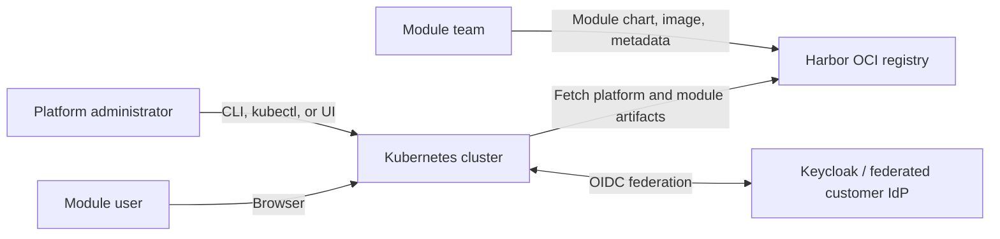
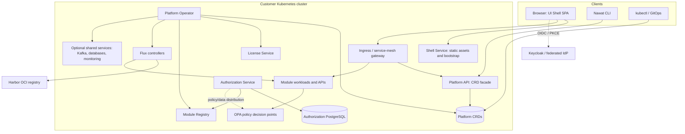
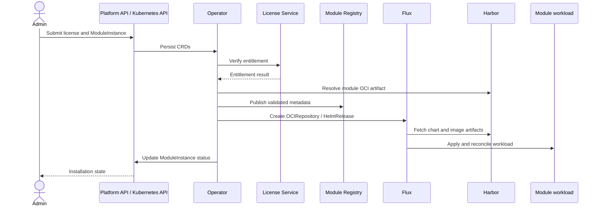

# Nawat Platform — High-Level Design

**Status:** Architecture baseline  
**Audience:** Engineering, operations, security, and module teams  
**Scope:** Platform architecture and its principal runtime flows

## 1. Purpose and vision

Nawat is a Kubernetes-based platform for hosting independently developed OSS/BSS product
modules. The platform provides shared identity, authorization, licensing, navigation, APIs,
and lifecycle management so that a licensed module can be installed and surfaced without
adding product-specific behavior to Platform Core.

The central architectural rule is that Platform Core remains domain-neutral. A module
describes its resources, permissions, navigation, and UI hints through the versioned module
metadata contract. Core components consume that contract rather than embedding knowledge
of products such as Mediation, Roaming, CRM, or Interconnect.

This document captures the intended architecture. The repository identifies the current
delivery phase as Phase 0 (contracts and inner loop); components and flows below describe
the target platform and may not all be implemented yet.

## 2. Goals and non-goals

### Goals

- Provide one installation and operations model for the platform and its modules.
- Make Kubernetes custom resources the durable platform API and desired-state store.
- Let modules be installed, upgraded, and reconciled independently from the platform UI.
- Generate common screens from module metadata, with runtime-loaded micro-frontends for
  genuinely domain-specific experiences.
- Enforce authorization at the API boundary and in module workloads, not only in the UI.
- Support customer-managed identities through federation and support air-gapped deployments.
- Keep contracts and generated clients consistent across the operator, services, CLI,
  browser, and module SDK.

### Non-goals

- Platform Core does not implement product-specific business logic or own module data.
- The operator does not implement Helm release management; Flux reconciles the Helm
  resources it emits.
- The Shell is not a proxy for module API traffic and does not make security decisions.
- Nawat does not become a second user directory; customer identity remains with the
  federated identity provider.

## 3. System context

The platform runs within a customer Kubernetes cluster. Administrators can use the UI, CLI,
or Kubernetes APIs/GitOps to manage platform resources. The browser and CLI call the
Platform API; users with cluster access can also interact with the CRDs directly. Module
artifacts are distributed as OCI artifacts through Harbor. Keycloak is the platform identity
provider and can federate authentication to a customer's upstream IdP.

## 4. Logical architecture

### 4.1 Contracts and schemas

The schemas define the shared boundaries:

- `schemas/module-metadata/` defines a module's identity, version, resources, permissions,
  navigation, and UI behavior.
- `schemas/platform-api/` defines the HTTP API used by the UI, CLI, and customer automation.
- Go and TypeScript types and clients are generated from the contracts; generated files are
  not edited by hand.

The metadata contract is the integration point between independently released modules and
the platform. Compatibility is versioned: additive changes are introduced compatibly, while
breaking metadata changes require a new API version.

### 4.2 Platform Operator and Kubernetes API

The Operator watches platform CRDs, verifies license state through the License Service,
discovers and validates module metadata, and reconciles module desired state. It provisions
declared capabilities and emits Flux `OCIRepository` and `HelmRelease` objects, along with
related routing, policy, and monitoring resources. It publishes installation progress and
health through `ModuleInstance` status.

CRDs are the durable configuration and status surface. The Platform API is a thin, user-facing
facade over these resources: it applies request validation and authorization and shapes API
responses, but does not maintain a competing platform data model.

### 4.3 Module delivery and registry

Module teams publish OCI artifacts containing module charts and workloads. The Operator
resolves an entitled module version, validates its descriptor and metadata, and records a
consistent metadata snapshot in the Module Registry. The Shell and other platform
consumers read this registry rather than fetching metadata independently from running
modules.

Flux applies and reconciles the emitted desired state, including retries and drift correction.
The Operator decides what should exist; Flux decides how to apply it.

### 4.4 Platform services

The services are separate binaries in one Go module and are released as part of
`platform-core`:

| Service | Responsibility |
|---|---|
| Platform API | HTTP facade over CRDs for browser, CLI, and automation clients |
| License Service | Offline signature verification, entitlement decisions, and runtime feature/quota checks |
| Authorization Service | Permission catalog, roles, bindings, field rules, and OPA policy data |
| Shell Service | Static SPA assets and the user-specific `/bootstrap` response |

Services expose health, readiness, and metrics endpoints and are designed to shut down
gracefully.

### 4.5 UI Shell and module UIs

The Shell is a generic React SPA. It builds navigation and routes from the bootstrap payload
and renders common resource list, detail, form, relation, and action screens from module
metadata and JSON Schema. Module-specific UI is loaded lazily as a Module Federation
micro-frontend only when required. Every module's custom UI uses the shared design system.

The Shell hides unavailable navigation and screens for usability and privacy; this is not an
authorization boundary. APIs independently enforce permissions.

### 4.6 SDK and CLI

The Go SDK provides module teams with contract types and helpers for metadata, resource
registration, authorization, licensing, observability, and API behavior. The CLI validates
module artifacts and provides an automation interface to the Platform API. Both help
consumers follow the platform contracts without depending on the Operator implementation.

## 5. Principal runtime flows

### 5.1 Module installation and reconciliation

1. An administrator uploads a signed license and requests a module installation through the
   UI, CLI, Kubernetes API, or GitOps.
2. The request is represented by platform CRDs. The Platform API is a facade for HTTP
   clients; direct Kubernetes clients can submit the same resources.
3. The Operator reconciles the license and module desired state. The License Service
   verifies the signed license and provides entitlement information.
4. The Operator resolves the module artifact, validates the descriptor and metadata, and
   registers the validated metadata snapshot.
5. An admission webhook validates module configuration against the module's values schema.
6. The Operator provisions declared shared capabilities and creates the Flux resources and
   related route, authorization, and monitoring configuration.
7. Flux applies the module workload from OCI artifacts and reconciles drift or failures.
8. The Operator reports observed state in `ModuleInstance.status`; the UI and CLI use that
   status to show progress and outcome.

### 5.2 User authentication, UI bootstrap, and API access

1. The user authenticates through the OIDC Authorization Code flow with PKCE.
2. The browser keeps access tokens in memory, not persistent browser storage.
3. On load, the SPA requests `/bootstrap`. The Shell returns navigation and metadata
   filtered for the user's effective permissions. The response can be cached by registry
   revision and permission-set hash and supports ETags.
4. The SPA builds generic routes and renders screens from metadata. Custom micro-frontends
   load on demand.
5. The browser sends subsequent Platform API and module API requests through the configured
   gateway. The Shell is not in this request path.
6. The gateway validates identity at the edge. APIs and modules enforce authorization
   server-side; module workloads consult their local OPA decision point through the SDK.

### 5.3 Authorization data and decisions

The Authorization Service is the write-side source of truth for roles, bindings, and field
rules; PostgreSQL is the system of record. It compiles role and binding state with the
platform's Rego policy and module-declared permission catalog into data for OPA. OPA is the
read/decision side and does not query PostgreSQL on each request. Decision inputs include
the authenticated subject and requested action/resource; results can include field
redactions or list-filter predicates.

The initial delivery phase uses bundle polling for correctness and recovery. OPAL-based
push distribution of changing authorization data is planned for a later phase; policy
bundles remain pull-distributed. Browser-side permission filtering is not a replacement for
server-side decisions.

### 5.4 License verification and use

The License Service is the sole component responsible for signature verification. Signed
licenses use a pinned Ed25519/EdDSA verification path and embedded public keys so verification
does not require an external service, including in air-gapped sites. The Operator uses
entitlement checks to gate new installs, while module code uses the license SDK for runtime
feature and quota checks. Expiry and grace behavior must not cause an abrupt interruption to
live telco workloads.

## 6. Data ownership and persistence

| Data | Owner / system of record | Notes |
|---|---|---|
| Platform desired state and module status | Kubernetes API / CRDs | Declarative, auditable, and suitable for backup and GitOps |
| Validated module catalog and metadata revisions | Module Registry | Shared snapshot for UI, CLI, and authorization catalog consumers |
| Roles, role bindings, and field rules | Authorization Service PostgreSQL | Compiled to OPA data; Redis, if used, is only a cache |
| Policy decisions and local policy snapshot | OPA instances | Local decision path; persisted policy data supports restart/outage behavior |
| Licenses and entitlement state | License CRD and License Service | CRD is API/storage; License Service verifies and owns license status |
| Module business data | Individual module | Platform Core does not own product-domain records |
| User credentials and upstream identities | Keycloak / federated customer IdP | Platform RBAC refers to users or groups; it does not replace identity management |

## 7. Security boundaries

- **Identity:** OIDC-based authentication through Keycloak, with federation to customer
  identity providers. Browser sign-in uses Authorization Code with PKCE.
- **Token handling:** Browser tokens remain in memory. Avoid exposing tokens to persistent
  browser storage.
- **Network edge:** The gateway provides routing and JWT validation; module APIs remain
  responsible for their own authorization enforcement.
- **Authorization:** The Shell may filter visible UI; the Platform API and module APIs
  enforce permissions server-side. Module workloads use OPA through the SDK.
- **Kubernetes access:** The Operator runs with scoped RBAC. The Platform API should act
  with the calling user's identity where applicable so API-server authorization and audit
  retain the real actor.
- **Supply chain:** Module charts and images are retrieved as OCI artifacts. The Operator
  validates module descriptors and metadata before publishing them for other consumers.
- **Licensing:** Verification is offline and uses a pinned algorithm and public-key keyring;
  private signing keys remain outside the repository and cluster.
- **Isolation:** Platform Core must not import product-specific module code. CRD and
  service boundaries limit coupling between control-plane components and module workloads.

## 8. Deployment, availability, and operations

The platform is delivered through one `platform-core` Helm chart, with optional dependencies
controlled by configuration profiles and flags. Dependencies can include Keycloak, the
service mesh/gateway, Flux, CloudNativePG, Strimzi, and monitoring components. Kafka is
intended to be provisioned on demand for modules that require it. Air-gapped deployments
configure a local image and artifact registry through the shared registry setting.

The Operator and Flux provide separate control loops: the Operator translates platform
intent into Kubernetes resources; Flux reconciles module release resources. Platform
services are stateless where practical; durable state belongs in CRDs or service-owned
datastores. The Shell is stateless static content plus bootstrap and can be restarted without
losing platform capabilities.

Operational baseline:

- `/healthz`, `/readyz`, and `/metrics` on platform services.
- Graceful service shutdown and Kubernetes health probes.
- Kubernetes events and CR status for lifecycle diagnosis.
- OpenTelemetry tracing and metrics following shared service conventions.
- CI validation for schemas, generated artifacts, charts, conformance, and end-to-end flows.

## 9. Quality attributes and key trade-offs

| Attribute | Architectural approach |
|---|---|
| Extensibility | Metadata-driven contracts and runtime-loaded custom UIs; product logic remains in modules |
| Consistency | Versioned schemas generate shared Go/TypeScript clients and types |
| Resilience | Kubernetes desired state, Operator/Flux reconciliation, stateless Shell, and local OPA policy snapshots |
| Performance | Direct browser-to-gateway API traffic; OPA decisions use local data rather than per-request database calls |
| Security | Layered edge validation and API enforcement; least-privilege Kubernetes RBAC; in-memory browser tokens |
| Air-gap support | Offline license verification and configurable OCI registry mirrors |
| Operability | Health/readiness/metrics, CR status, and standard Kubernetes deployment mechanisms |
| Independent delivery | Separately versioned module artifacts and SDK; platform core remains product-neutral |

Trade-offs include the operational cost of Kubernetes operators and shared infrastructure,
the need for strict compatibility management around public contracts, and the potential
version coordination burden of a shared design system. Module Federation allows independent
module UI delivery but requires compatible shared React dependencies and runtime remote
availability handling.

## 10. Phasing and open decisions

- **Phase 0 — contracts and inner loop:** define schemas, generated clients, validation, and
  the development workflow. This is the repository's stated current phase.
- **Phase 1 — walking skeleton:** prove an end-to-end install and UI flow with the
  `hello-module`, Platform API, Operator, services, and Shell.
- **Phase 2 — production capabilities:** harden the platform and add planned optimizations,
  including OPAL push distribution after bundle polling works correctly.
- **Phase 3 — first real module:** validate the architecture against a production product
  module.

Decisions still needing an explicit ADR or validation include the ingress/gateway choice
(Istio versus Envoy Gateway) and the OPAL data-distribution spike. Consult the ADR index and
rollout plan for current decision status and sequencing.

## 11. Related documents

- [Repository overview](../../README.md)
- [Documentation index](../README.md)
- [Platform core component decisions](02-platform-core-components.md)
- [Platform concept](keynote.md)
- [Module metadata contract](example__metadata__.md)
- [Platform API contract overview](../../schemas/platform-api/README.md)
- [Module metadata contract overview](../../schemas/module-metadata/README.md)
- [Implementation rollout plan](10-rollout-plan.md)
- [Architecture Decision Records](../adr/README.md)
